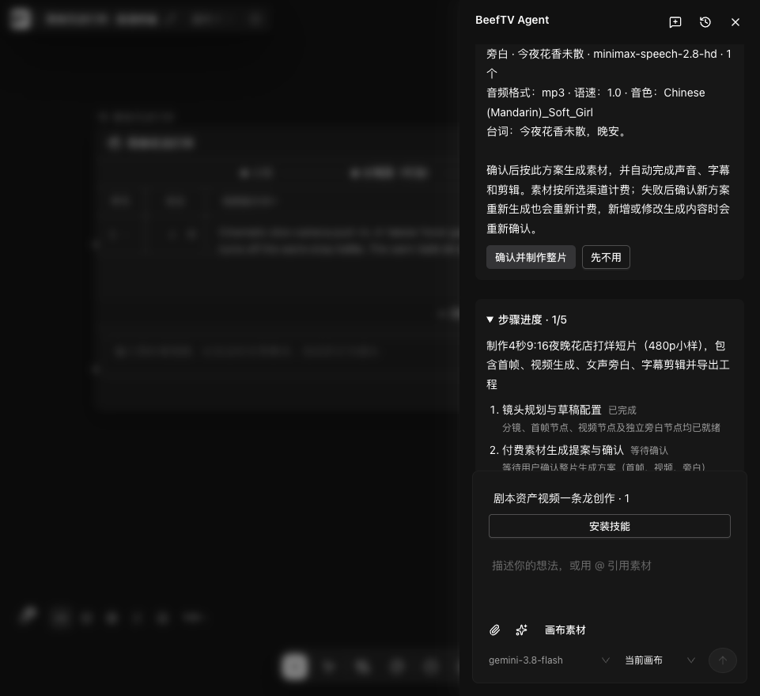
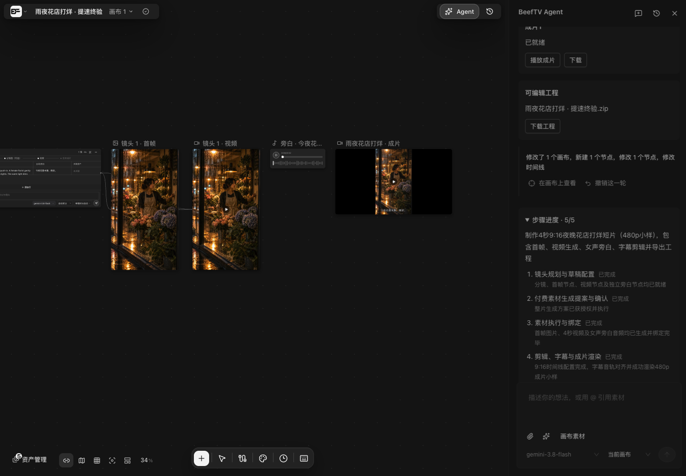
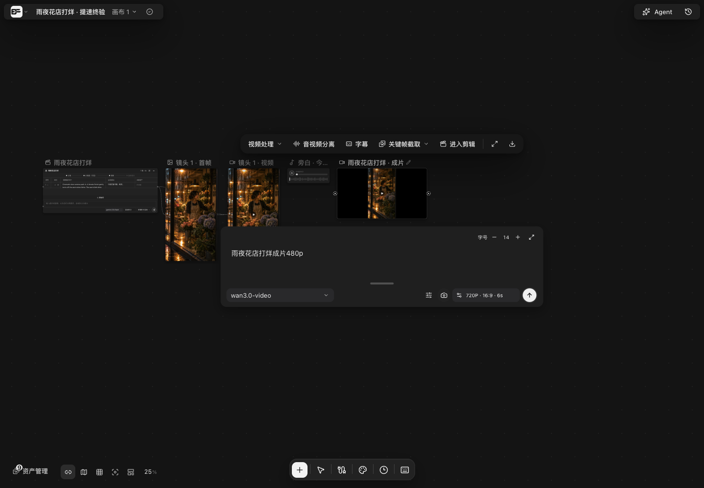
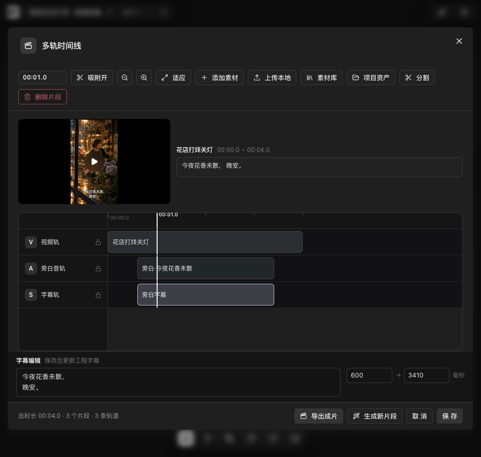
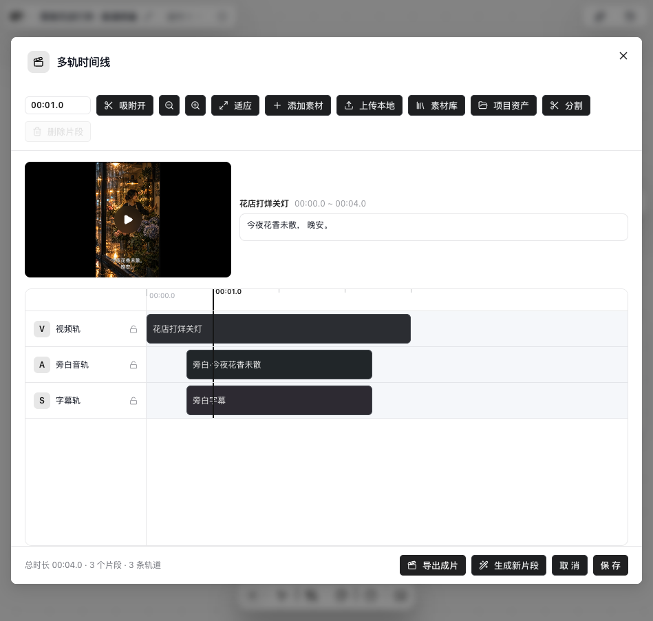

# 内置助手一次确认制作：实现与验收

本次是在 #192 的画布创作工具之上补齐完整制作流程。用户确认有限素材方案后，助手可继续图片、视频、独立配音、字幕、时间线渲染和原生工程导出；关闭助手面板不会结束已确认的制作。官方 Pi Durable 1.2.0 仍是唯一模型执行循环，Go 复用已有任务、资源和本地 FFmpeg，不增加队列服务、工程格式或依赖。

这是本地候选的实现及测试记录，不代表已合并、正式桌面包或全部创作需求通过。#192 尚未合并，本次作为其后续增量审阅。

## 实施状态

| 阶段 | 当前结果 | 尚未覆盖 |
| --- | --- | --- |
| 后台接续 | Go worker 使用原 Durable 身份推进已确认制作，前端离开不负责唤醒；Stop、新意图和会话切换取消后续写入 | 完整应用退出/重开后的真实整片矩阵 |
| 有限素材方案 | 一次确认固定节点、模型、提示词、数量、参数和参考关系；原子保存授权、首批任务和接续；稳定任务键复用原任务 | 人民币预算硬封顶，全部供应商与模型组合 |
| 声音与可编辑交付 | 真实中文音色目录、独立语音生成、字幕/音量/输出规格、成片与原生 v4 ZIP；工程含实际素材。视频可直达项目剪辑，预览同步独立音轨 | 当前兼容配音路径不支持自由朗读指令；品牌文字一致性、复杂叙事与长片 |
| 减少机械往返 | Go按已确认依赖推进首帧、视频与独立声音；素材齐后才唤醒Pi。交付组合复用原生时间线保存、渲染、绑定和工程导出；短片取证组合已真实验证 | Gemini通道曾出现120秒响应和流超时；不能仅凭减少回合承诺总耗时 |
| 真实短片验收 | 单镜及12秒3镜头小样已自动交付；有效确认后无人工续做、制作期无源码修改。通过/未达标记录见下表 | 小样不代表长期成功率、所有供应商或正式发布 |

## 运行责任与失败处理

- Go 保存授权、任务和业务回执。后续 `canvas.generation.submit` 只执行已确认的精确输入，不能用历史上下文扩大付费范围。新增素材或修改已确认输入需重新确认。
- 生成受理之后由官方 Durable 工具等待原任务成功、资源保存及节点绑定；观察失败返回原任务身份和 pending，Stop 仍中断。未知结果不触发替代购买。
- 复用失败或取消任务时保留真实失败与错误文本，不显示为新的生成中，不另下一单。普通迟到轮次保存不能擦掉已确认授权。确认响应丢失后，后台已领取/运行/完成的相同清单可只读重放并返回原任务；新增、更改或已停止的清单仍被拒绝。
- `model.catalog.capabilities`、新 `canvas.script.prepare.script` 和跨类型提交复用已有操作层。剧本、草稿及引用在一次 revision 提交，回滚、重放及撤销使用原业务机制。
- 渲染仍是已有本地任务。宿主在业务事务提交后等待产物；公开渲染操作的受理语义不变。
- 时间线保存画幅、帧率、音频采样率及轨道。只改字幕时不丢失合法输出规格。原生 ZIP 包含源视频、独立语音、图片和最终成片，资源引用由既有工程导入逻辑映射。
- 等待生成绑定后返回实际读到的当前画布 revision，避免把准入版本交给下一次编辑；不修改 Go 持久操作回执，也不绕过并发版本校验。

数据库与操作参数变化见 [数据库说明](../content/docs/backend/backend-database.mdx)、[HTTP API](../content/docs/backend/http-api.mdx)；官方组件责任见 [Pi 复用矩阵](pi-official-reuse.md)。

## 真实验收

早期单镜头验收输入（冻结c35c8136）：

> 做一支4秒9:16的夜晚花店打烊短片，雨后街灯映在玻璃上，店员轻轻关灯，配一句独立女声中文旁白和对应字幕，自行设计镜头并从头生成素材、剪辑，交付可播放成片和可编辑工程；先做480p小样。

实际运行使用全新空画布、真实 Go 后端、官方 Pi 和 React 界面：一次创作输入、一次有效确认（HTTP 200），随后关闭助手面板，自动完成图片、视频、独立语音、字幕/混音、渲染和工程导出。没有人工续做、补提示或操作者制作工具调用。制作期间冻结在 `c35c8136`，源码哈希保持不变。

| 检查 | 结果 |
| --- | --- |
| 输出 | 4 秒，480×854，24fps，44.1kHz AAC，完整解码成功 |
| 声音 | 源旁白和最终混音经无预期文本提示的本机 ASR，均读回“今夜花香未散，晚安”；平均音量 −18.2dB、峰值 −4dB |
| 字幕 | 实际成片抽帧可读，0.600–3.410 秒；不是逐字高亮或逐音素精确验收 |
| 播放 | 实际 GUI 播放，readyState=4、播放中、未静音、音量 1 |
| 工程 | ZIP CRC 与四份媒体引用齐全；含最终成片且与独立视频 SHA256 相同 |
| 下载/导入 | 结果卡下载与原包字节相同；重新导入打开三轨三片段时间线，规格、字幕、时点和媒体哈希保持；资源 ID 正常重新映射 |
| 自动恢复 | 三次版本冲突由模型读回后恢复，未要求人工干预；不将其记为无错误运行 |
| 创作差距 | 关灯动作和氛围出现，灯光只变暗而未完整熄灭，不算内容要求全部通过 |

确认前，测试观察脚本因未识别 medium 图片质量的价格预检而恢复过；恢复同一提案，没有重发创作、授权或任务。这不是产品制作期间的修复，但不能声称测试设施也零恢复。报告用业务库与官方 Durable 时间戳重建耗时，未采用观察器跨恢复的计时。

前一轮 6 秒 720×1280 咖啡店还验证了 GUI 改字幕、保存重开和再次导出仍保持竖屏及音轨；最初确认凭据缺失和开发预览恢复均保留为历史失败，不以之后成功抹去。新花店工程只验证重新导入和可编辑时间线，未另改稿再导出。

### 实际界面

以下都是本地候选的真实界面。导航、画布、结果卡和工程入口保留完整，非正式发布截图。

确认的素材方案：

后台制作完成后的视频与工程交付：

视频及最终成片节点可直接“进入剪辑”，打开同一份工程：

从“全部项目 → 导入画布”重新导入工程，打开三轨时间线并修改字幕：

时间线外壳与文字采用当前画布主题颜色，避免浅色主题下深色外壳和浅色控件混用：

预览按工程输出画幅显示，字幕复用浏览器导出的 PNG 排版后缩放，避免竖屏小预览中固定字号造成大字多行；原生 FFmpeg 的 libass 字体仍可能与浏览器有像素差异。独立音轨与视频共用预览时钟，支持源内裁剪、音量、淡变、静音、暂停及拖动；媒体尚未准备好时等待，不能让播放头先越过声音。预览不支持超过100%的增益，会明确暂停提示，导出的原有音量合同不变。

本轮复用花店真实素材验证：预览能播到4秒自然停止并重新播放；字幕改为两行后保存重开仍在。界面再次导出为4秒、480×854、24fps、44.1kHz立体声，完整解码通过，本机ASR无预设文本读回“今夜花香未散晚安”；实际帧保留两行。另导出的原生v4工程保留三轨、输出规格和修改后的字幕，四份原媒体保持。没有新增模型或供应商请求。

## 早期耗时基线与验证范围

| 指标 | 旧咖啡店 | 新花店 |
| --- | --- | --- |
| 规格 | 6 秒 / 720×1280 | 4 秒 / 480×854 |
| 规划主响应 | 14 次 / 151.559 秒 | 10 次 / 84.098 秒 |
| 确认到产品持久化完成 | 822.242 秒 | 602.446 秒 |
| 确认后主响应 | 21 次 / 406.956 秒 | 19 次 / 240.916 秒 |
| 素材齐后到完成 | 343.352 秒 / 17 次 | 213.778 秒 / 16 次 |

新轮视频任务 295.771 秒，语音 3.327 秒，两任务在同批受理、创建相差约 5 毫秒；语音等待包含在视频等待内。渲染任务约 2.535 秒，包含在工具等待中。全程 29 条主模型响应，另一次后台压缩与主执行重叠，不能把压缩时间另行相加。

原素材复用的成功轮次约 164 秒、16 次主响应、无新媒体购买；此前两轮分别触发测试 profile 请求上限与模型通路的损坏多工具参数，均保留。复用需求的“两行字幕”被做成两段顺序字幕，不能算该排版要求通过。

任务和规格不同，以上不是严格同需求 A/B；不把全部差异归因于代码，也不宣称制作回合减半。速度目标仍未达到，供应商视频和素材齐后的模型往返需分别继续优化。

第九轮后修正了等待器返回旧准入 revision 的问题，以及确认请求在后台接手后的相同清单重放问题，已有免费定向回归和独立复核；这些补丁不计入冻结 `c35c8136` 的真实成片验收，没有为它们重复购买新素材。

新增 `media.overview.evidence`，将短成片的 overview、原生影音读取和客观检测合为一次同版本取证，保留实际内容与逐项检查记录。宿主与Go本地回归以及后续茶摊、面包店真实影音读取均通过；原有版本冲突仍须读取最新画布后处理，不自动覆盖版本。

Mac锁定依赖、含空格路径、包内导入与零模型启动三项打包测试已通过。分段诊断观察到启动主要耗在官方SDK导入，之前的包内20秒空日志超时未再次复现；预算测试的15秒等待与生产20秒不一致，统一为20秒后崩溃/预算恢复回归通过。没有延长生产等待期限或据此宣称启动性能问题全部消失。

## 新增200元目标迭代

继续使用官方Durable唯一模型循环，没有新引擎、任务表或队列。`canvas_timeline_deliver`是一次官方持久工具内的原生操作组合；每一步有独立稳定key和Go回执。字幕可用`lines`提供真实分行。渲染期间其他编辑仍会产生版本冲突；导出失败只补原失败步骤，不重新运行整次交付。

Go在既有continuation claim事务里推进已确认素材：独立旁白不等图片，各视频只等自己的首帧实际保存并绑定，全部素材就绪后才叫回Pi。失败目标不再抢先消费仍在运行的兄弟任务的接续；已确认内容变更会取消原接续，不再永远等待。Stop仍阻止新的受理，已付费结果保留，未知结果不触发重买。

以下均为真实模型、Go任务和实际媒体，制作时冻结代码；最终说明与文件保存分别计时。文件时刻取实际render资源和工程导出回执，不把它冒称结果卡已即时呈现。耗时包含并行阶段，不能直接串行相加。

| 工作流 | 实际结果 | 文件可用 | 非最终主响应 | 最终完成 |
| --- | --- | --- | --- | --- |
| 原花店改双行字幕与旁白-3dB | 4秒，0新媒体，质量及效率通过 | 输入后28.113秒 | 6次 | 52.293秒 |
| 全新雨夜茶摊 | 12秒/3镜头；一次确认7项、0人工续做；内容及尾段目标通过 | 素材齐后70.118秒 | 素材齐后8次 | 全流程737.188秒，素材齐后112.075秒 |
| 全新晨光面包店，Gemini3.7试验 | 12秒/3镜头/720×1280；一次确认、0人工续做，ASR台词、字幕、ZIP及媒体通过；147.848秒超过120秒目标 | 素材齐后147.848秒 | 素材齐后6次 | 全流程750.197秒，素材齐后397.772秒 |
| 默认模型复用上述面包店改稿 | 旁白-3dB、真实双行字幕，保留12秒/3镜头/30fps/48kHz；0新媒体、0人工续做 | 输入后55.859秒 | 7次 | 80.704秒 |

面包店的图片到视频无需中间模型调用。实际视频供应商等待并行合计88.314秒、传输并行合计2.252秒，本地渲染3.814秒；未有传输边界的内联图片/声音仍保持未知，不记成0秒。主模型是该轮主要等待：计划更新120.558秒仅输出236 tokens，交付参数约3KB只用9.587秒；上游日志也记录120秒。该轮后来审片又流超时，不能把它写成效率通过。

两款Gemini走相同通道的试验没有证明稳定性收益，因此撤回临时增加的3.7候选，产品默认模型和原有候选范围保持。默认模型的面包店改稿通过画面与客观音轨检查，明确没有原生音视频试听；不能把音轨检测当作听清台词。Gemini路径的原生影音、本机ASR、媒体引用/增益和实际字幕帧分别记录，不相互替代。

早先的Wan并发失败、指定可灵却因缺配置改用Wan、三次流超时、测试价格检查误拒`auto`质量均保留。Wan失败退款6.48元读回，未无授权重买；模型约束已修并有真实缺模型负例。测试档案通过现有目录刷新取得可灵，未绕过managed配置。仅保存旧素材的成功不能冒充从零新片验收，未达到时间目标的成片也不补写通过。

真实Go回归覆盖渲染受理后杀Node、重开同一个Durable并绑定原任务，ZIP包含非空实际媒体；SDK补导出恢复、超大绑定回执投影、外部版本修改等场景。只读阶段报告从Go与官方SQLite取数，隔离同画布旧render和结束后新增消息/任务/操作；真实SQLite回归已加入CI。它不是完整历史快照：后来的compaction和同一任务追加phase日志仍有计数限制。

最终新增工作流、费用核算与当前CI见本PR的验证记录；以上是对应冻结跑次的证据，不声称长期成功率，也不把不同模型、供应商和任务的差异全部归因于代码。

后续默认模型新片以333.007秒自行完成，素材齐后51.303秒/7次非最终响应交付；高清抽帧发现单行字幕贴边，仍未计为质量通过。真实黑底编码回归重现旧版字形距左边仅7像素。修复保留文本和显式换行，按实际输出设置libass画布、字号与边距，浏览器字号也按竖屏宽度限制。原生实际像素与浏览器PNG、真实FFmpeg/Wasm混音专项通过；复用素材与新的冻结整片验收随后分别记录。

## 审阅与下一步

本次代码包含原子授权/回滚/重放、任务复用、迟到保存、Stop/新意图、音色目录、输出规格、工程清理引用、渲染与宿主观察回归；具体 CI 结果以当前 PR 为准。真实模型、GUI 验收与无收费替身测试分别记录，不将局部检查称作完整发布矩阵。

本轮独立复核曾发现低刷新频率下预览回跳、自然结束/重播及静音轨错误处理问题，已单独修复，并用240ms帧间隔及真实浏览器回归再次验证。未发现需要再增加运行时或依赖的结构问题。当前CI以PR的最新头为准；合并前仍需用户可见功能交叉review，正式桌面发版单独验证。

后续优先验证主模型通道延迟、多样本成功率和长片；腾讯托管Agent正式接入、默认引擎切换、人民币预算硬封顶均不在本PR。小样可自动交付，不代表所有创作需求或正式产品稳定性已通过。
