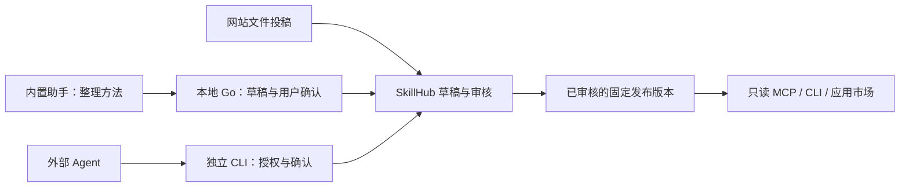

# Skill 市场：Agent 接口与前端交接

2026-10-17。本文固定当前实现的接口与协作边界；源码、测试通过、页面可用和公开部署分别记录，不能互相替代。官网及新增前端交互由反重力负责，Lucas 做用户路径与文案评审。Codex 负责本文件涉及的 Go、agent-host、CLI 和接入包。

## 一个市场，三种投稿入口

市场目录、账号作者、私有草稿、预览摘要、审核与不可变版本由 BeefAPI 的 SkillHub 服务统一管理。文件上传、内置助手和外部 Codex/Claude Code 最终使用相同服务，不建三个市场。首版接受说明、数据和图片，不执行投稿代码。



外部 CLI/MCP 不要求安装或运行桌面端。`beeftv skills` 在本机运行时发现之前分派，与既有 `beeftv mcp serve` 的本机画布入口分开。产品没有开放通用代码插件、脚本沙箱、付费技能、私有市场或团队功能。

## 公共服务合同

默认 HTTPS 根：`https://beeftv.app/api/beeftv/skillhub/v1`。本地联调通过 `BEEFTV_SKILLHUB_URL` 或 CLI `--market` 指定独立服务；HTTP 只允许显式 loopback 地址。公开查询不携带桌面凭据、投稿凭据或模型 Key。

| 调用 | 返回 / 语义 |
| --- | --- |
| `GET /search?q=分镜&target=codex&page=1&pageSize=20` | 紧凑结果；最多20条，含 skillId、releaseId、用途、许可、要求和兼容状态 |
| `GET /catalog` | 保留既有完整 Release 列表，供网站展示详情资料 |
| `GET /skills/:skillId` | 已公开的发布历史 |
| `GET /skills/:skillId/releases/:releaseId` | 完整 Release 和文件清单；不跟随 latest |
| `GET /skills/:skillId/releases/:releaseId/discovery?target=codex` | `{release,compatibility,verification}`；按请求目标检查声明要求，不改写被签名的 Release |
| `GET /skills/:skillId/releases/:releaseId/archive` | 指定版本 ZIP |
| `GET /skills/:skillId/releases/:releaseId/file?path=SKILL.md` | 指定清单文件原始字节；attachment、nosniff、文件 SHA ETag |
| `POST /mcp` | 普通只读工具：skill_search、skill_get、skill_read_file；JSON-RPC/MCP |

REST 使用 `{success:true,data}` / `{success:false,message,reason}`。MCP 使用其自身信封；错误为 `isError:true`，文本内保留 status、reason、message，不返回空白成功对象。无状态服务不提供 SSE；GET 到达 SDK 后返回405（Allow: POST），带会话 ID 的 DELETE 返回204，不应被路由或企业站边界改成404/503。

查询项的 `compatibility.status` 有三种：`supported` 仅说明声明要求全部在调用者提供的 capabilities 中；缺少要求为 `unsupported`，reasons 中给出 `missing_capability:<id>`；最低客户端版本未核对为 `unverified`。`verification:"unverified"` 独立表示未进行目标宿主认证。页面不能把这些字段变成“Codex 已验证可用”。应用当前只声明自身的 `beeftv.canvas`，不猜测用户已有供应商或视频理解能力。

`tags` 与 `aliases` 是可选投稿字段，各最多16项、每项最多80字符。中文与英文别名按字面匹配；不提供向量搜索或“全社区都能搜到”的承诺。历史官方包仅更新检索索引，不改写旧发布身份、ZIP 或签名载荷。

### 官网 PR #18 的接入差异

官网 PR #18（`433f9f7`）目前从 `release.compatibility[]` 读取目标矩阵。这不是服务返回的合同：`/catalog` 和原 Release 都不包含该动态数组。详情页应按实际目标调用 `/discovery?target=beeftv&capability=beeftv.canvas`、`/discovery?target=codex`、`/discovery?target=claude-code`，分别读取响应外层的 `compatibility.status`、`compatibility.reasons[]` 和 `verification`，由页面合成矩阵。未提供的能力不能被推断为已有；`supported` 只代表声明要求满足，页面应将“声明要求满足”和“宿主尚未验证”分别表达。原 Release 必须保持不变，不能为配合页面补写已签名发布对象。

`reasons` 是机器码，例如 `missing_capability:beeftv.canvas`，应由前端映射成用户能理解的提示。搜索字段 REST 使用 `q`，MCP `skill_search` 使用 `query`。官网目前仍读取 `/catalog?q=…`；新增 `/search` 是紧凑的 Agent 查询接口，不能直接把其条目当作完整 Release。两者都保留，按页面所需资料选用。

`skill_read_file` 的 offset/nextOffset 是原始字节位置，默认32 KiB、最多64 KiB；UTF-8 不截断字符，二进制用 base64。必须读取到 eof 才能声称读完；读取内容不等于授权执行或激活。原始 REST 文件最大2 MiB，服务先验证发布包和对应文件的大小与 SHA。

完整账号、投稿、审核 API 与 OpenAPI 位于 API 仓库 `docs/beeftv-skillhub-api.md`、`docs/beeftv-skillhub.openapi.json`。

## 给反重力：网站与桌面调用顺序

### 网站文件投稿与外部对话投稿

网站复用已有会话身份和同源代理：浏览器写入带 `Origin` 或同源 Referer、`X-Requested-With: XMLHttpRequest`、`New-Api-User`，不能在页面存放模型 Key 或私有对象地址。

文件路径：填写元信息 → `POST /submissions`（稳定 Idempotency-Key）→ 上传 ZIP 与 revision → validate → preview → 用户确认这版公开内容 → submit（revision、previewDigest、稳定 Idempotency-Key）。只上传是私有草稿，审核通过才进入公共目录。

对话路径：提供官方投稿 Skill 和 CLI 指引/口令 → 外部 Agent 整理用户选定的文件 → 打开 `verificationUrl` 完成账号授权 → Agent 上传私人草稿 → 作者查看实际预览并确认 → Agent 送审。浏览器授权页根据 userCode 读取授权，显示真实 clientName 和 scopes，再由用户点击 approve。不能让 Agent 使用浏览器 Cookie 代替专用授权。

审核页使用管理员会话：列出 submitted、查看准确 revision 的文件、批准/退回。作者不能自审。下架只停止继续分发，不删除用户本地副本。不要把未知、未审核和下架版本回退到另一个版本下载。

### 桌面已恢复的后端

以下路径以本机 `/api` 开头，沿用本地身份和桌面信任校验；成功信封为 `{code:0,data,msg}`，与远程 REST 的 success 信封不同。

| 路径 | 请求 / 结果 |
| --- | --- |
| `GET /skills/market/search` | q/page/pageSize，紧凑结果，target固定beeftv |
| `GET /skills/market/catalog` | 网站式完整 Release 列表 |
| `GET /skills/market/releases/:skillId/:releaseId` | 指定完整版本 |
| `POST /skills/market/install` | `{skillId,releaseId}`；验证包、许可、要求、最低版本，保留来源 |
| `GET /skills/market/versions/:skillId` | 已安装版本 |
| `POST /skills/market/fork` | `{skillId}`，复制为私人改编，保留原来源 |
| `POST /skills/market/rollback` | `{skillId,versionId}`，选择既有版本 |
| `POST /skills/market/authorization/start` | 返回 userCode/verificationUrl，不返回 token |
| `GET /skills/market/authorization` | 查询/轮询授权状态 |
| `DELETE /skills/market/authorization` | 断开投稿授权 |
| `GET /skills/market/publish-plans` | 本地投稿计划 |
| `POST /skills/market/publish-plans` | `{skillId,metadata}`，准备本地计划 |
| `GET /skills/market/publish-plans/:id` | 读取冻结的文件、摘要与元信息 |
| `POST /skills/market/publish-plans/:id/upload` | `{confirmed:true,archiveSha256}`，仅用户确认动作调用 |
| `POST /skills/market/publish-plans/:id/refresh` | 重新取得服务器预览；内容改变后必须再确认 |
| `POST /skills/market/publish-plans/:id/submit` | `{confirmed:true,revision,previewDigest}`，公开送审确认 |
| `GET /skills/market/submissions` | 账号的服务器草稿/审核状态 |

`PublishPlan` 包括 planId、skillId、versionId、contentHash、archiveSha256、files、metadata、instruction、status、可选 canvasId/source/submissionId/revision/preview。`source` 是原发布资料；不要把私人改编标为原作者的新发布。可见状态包括 awaiting_upload_confirmation、uploading、needs_preview、awaiting_submit_confirmation、submitted、published、rejected、withdrawn，以实际响应为准。

内置助手可调用 `skill.draft`、`skill.publish.prepare`、`skill.publish.status`，以及 `skill.market.search/get/file`。上传、送审、审批不在模型工具目录；前端根据 prepare 的 plan 渲染确认操作。准备成功只能说“已准备”，不能说“已上传”。当前画布身份与 read-only/canvas/full-access 权限仍由 Go 强制检查。

通用本机业务工具目录也只收录市场的只读查询，不收录投稿授权、私有投稿计划或确认动作；实际外部请求使用同一目录校验，不能只从列表中隐藏。外部 Agent 投稿使用独立 CLI 的浏览器授权链路，不复用桌面 UI 的确认权限。

### 活动技能上下文

用户选择仍携带 `{skillId,versionId,contentHash}`，原回合已选版本不会被更新覆盖。Go 保存当前会话的活动 pin、revision 与变更回执；agent-host 在每次模型请求前重新构造活动正文，恢复、重启与压缩后也不能仅依赖历史 loaded 标记。文件丢失、卸载或摘要不一致时阻断请求并说明需要重新选择。

Go 内部 `/assistant/runtime/canvases/:canvasId/skill-context` 只供可信宿主；前端通过现有助手代理 `GET /assistant/canvases/:canvasId/skill-context?sessionId=...` 和 `POST /assistant/canvases/:canvasId/skill-context` 使用上下文动作，body 为 `{sessionId,action,expectedRevision,requestId,pins?}`，动作包括 activate、clear、new_scope。宿主按同画布排他锁处理；独立任务会使用官方会话 reset，历史对话展示保留。`skill_load` 明确表示加载并在本会话持续使用，不再标作纯只读；`skill_file` 只检查文件。

### 页面必须区分的状态

| 事实 | 页面处理 |
| --- | --- |
| 200、items为空 | 展示没有匹配结果 |
| 503、enterprise_service_not_configured / market_unavailable | 市场暂时不可用，可重试；不能显示“暂无技能” |
| 404、not_found | 指定版本/文件不可获取，不切换 latest |
| 409、revision/preview 冲突 | 保留原稿，重新取得预览与确认，不自动重新投稿 |
| 429、slow_down / Retry-After | 按服务器建议等待，不忙轮询 |
| capability缺失 / client版本未核对 | 展示缺少什么，不把可下载写成可运行 |
| 安装成功 | 只确认已安装；是否选择并用于本轮另行显示 |

业务操作的远端错误保留 reason，`details.upstreamStatus/retryAfter` 记录原状态；本地市场 HTTP 也保留远端失败。用户文案面向创作者，不展示内部 Go/SDK/签名算法等实现说明。

## 外部 Agent CLI

从仓库根目录构建：

```sh
go -C backend build -o ../.local/bin/beeftv ./cmd/beeftv
.local/bin/beeftv skills help
```

可读查询：

```sh
beeftv skills search 分镜 --target codex --json
beeftv skills show SKILL_ID --release RELEASE_ID
beeftv skills fetch SKILL_ID --release RELEASE_ID --output ./reviewed-package
beeftv skills install SKILL_ID --release RELEASE_ID --agent codex --scope project --project ./my-project
```

fetch 不写宿主目录；install 必须指定 agent 和 scope，不覆盖原目录，不声明已激活。项目 Codex 路径为 `.agents/skills/<SKILL-name>`，Claude Code 为 `.claude/skills/<SKILL-name>`；用户作用域尊重现有宿主配置。名称来自标准 SKILL.md；来源、许可和清单写入 `.beeftv-install.json`。校验失败不落入目标目录。

`show` 输出 `{release,compatibility,verification}`；install 需服务器的声明兼容状态为 supported，缺失状态按 unverified 拒绝安装。安装结果的 integrity 记录源与摘要校验，verification 仍为 unverified，不能把摘要校验当成宿主认证。

投稿先在目录外保存 metadata JSON（name、description、license、versionLabel 等），并使用目录外的私有状态文件：

```sh
beeftv skills inspect ./my-skill --metadata ./metadata.json
beeftv skills authorize --state ./private/publishing.json
beeftv skills poll --state ./private/publishing.json
beeftv skills upload ./my-skill --metadata ./metadata.json --state ./private/publishing.json --confirm-upload --content-hash HASH --archive-sha256 HASH
beeftv skills preview --state ./private/publishing.json
beeftv skills submit --state ./private/publishing.json --confirm-submit --revision REVISION --preview-digest DIGEST
beeftv skills status --state ./private/publishing.json
beeftv skills revoke --state ./private/publishing.json
```

`publish` 是 inspect 的准备入口，不会自动上传。authorize 只展示用户码和授权链接，按 interval poll；poll 再读取专用授权的 session，显示并绑定 userId/用户名。上传和送审前复核同一账号，回执带账号信息；更换账号必须使用原账号继续或另建投稿状态，不能静默转移旧稿。授权30分钟过期，同账号重新授权继续同一 state 可保留原投稿身份。

状态文件在 Unix 使用0600，在 Windows 设置并核对仅当前用户可访问的受保护 DACL；市场绑定、并发排他锁、原子写入，不能交给模型读取或上传。Windows ACL 另有平台用例，跨平台编译不等于 Windows 实机通过。进程异常留下锁时先确认没有写入进程，再处理该明确锁文件，不自动删锁抢占。上传丢回执重试原状态，服务与 CLI 共用稳定创建/送审幂等编号。

CLI 返回 JSON；失败非零退出，reason 决定分支。3=未找到、4=冲突/完整性、6=授权、8=远端参数/校验、9=限流或服务不可用；本地参数错误为2。不要从中文 message 解析逻辑。

## 原生宿主入口与发布顺序

仓库 `.agents/plugins/marketplace.json` 和 `.claude-plugin/marketplace.json` 指向 `plugins/beeftv-skills`。该包仅带查找与投稿两个工作流，以及公共只读 MCP 连接；全部社区内容仍由服务目录管理。它不自动修改本机 Agent 配置，也不包含用户凭据或安装脚本。

Agent Plugins 1.0 的 root plugin.json/mcp.json 已按官方机器 schema 校验；Claude 兼容清单使用 `claude plugin validate ./plugins/beeftv-skills --strict`。OpenAI 文档所示 server.extensions.auth 与当前 portable MCP schema 的 additionalProperties:false 不一致，当前使用官方同页的基础无认证 HTTP 配置，避免携带 schema 不接收的可选字段。格式校验不等于宿主已安装、启用、MCP 已连接或公共精选目录已上架。

落地顺序：后端合并和受控测试部署 → 反重力接官网授权/投稿/审核及桌面确认 → Lucas 真实路径评审 → 文件/内置/外部三路联调 → 单独发布 CLI 产物和宿主接入包 → 生产与国内实际网络验收。公开服务未可用前不宣传安装入口已可用；COS/CDN 或双源下载仍是后续真实网络验收事项，不用当前 Mac 网络推断国内可用性。

验证命令与实际输出放在本任务实施记录，不能以本文合同代替通过记录。所有自动化使用隔离临时 SQLite、合成账号/模型替身与 loopback；没有消费真实生成额度、更新用户真实库或安装桌面候选。
