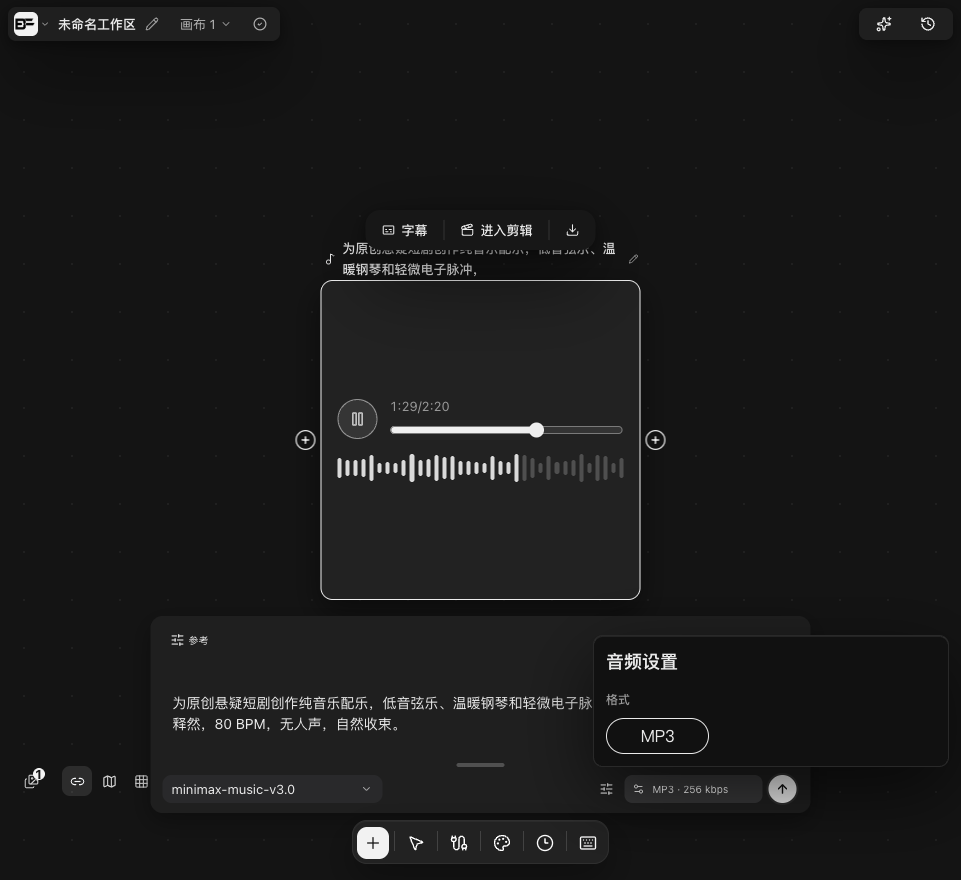

# Music 3.0 修复候选验收

此记录是发布前的候选测试，不表示正式客户端已经发布。

修复音乐长同步请求的等待方式、默认码率和格式显示。企业音乐默认 MP3 / 44.1 kHz / 256 kbps；旧 FLAC 设置归一为 MP3。随包 `openai-audio` 插件映射音乐参数并解析 SSE 完成结果，只有有效音频才保存成功，不自动重发生成。

本地候选连接真实腾讯渠道：API 请求耗时 180.29 秒，等待期间每 15 秒收到心跳，取得 138.14 秒 MP3；BeefTV 隔离桌面后端及 Web 预览单次提交 99.02 秒完成，取得 140.21 秒 MP3。两文件均实测为 44.1 kHz / 256 kbps，完整解码通过。BeefTV 保存、主页重开、播放、下载通过，导出与持久化资源字节一致。

空输入与不支持格式在发上游前 HTTP 400。相关 Go 全包测试、心跳 race 测试、前端 9 项测试及构建通过；独立代码审查通过。正式安装包、公网代理和生产账单待发布后核对。

