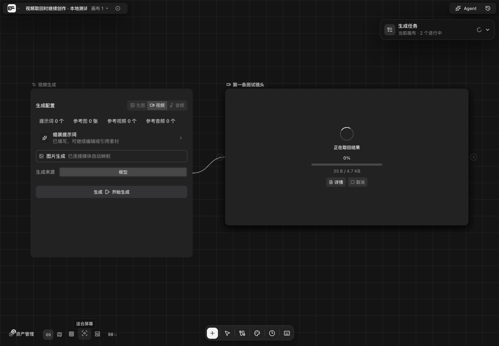
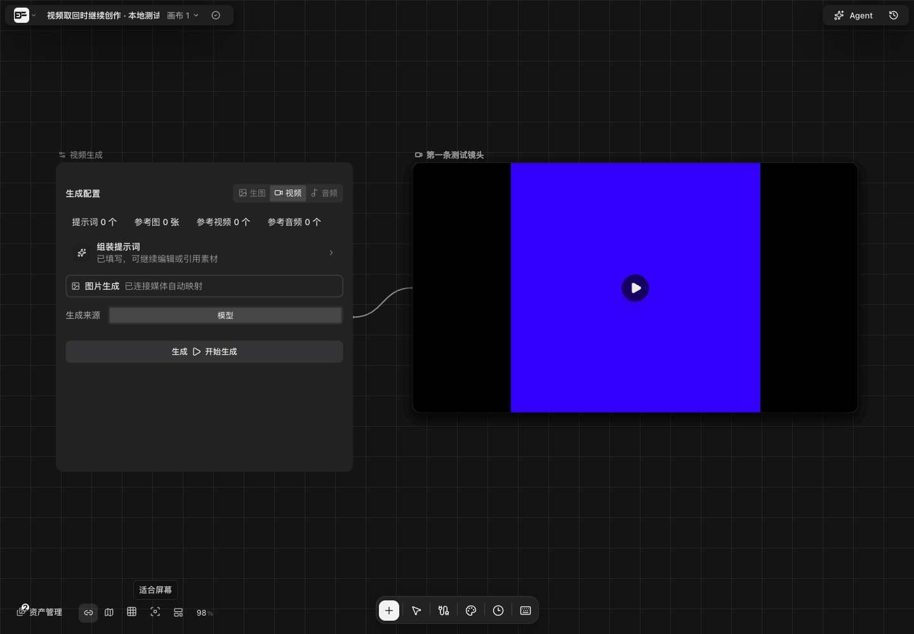

# 素材传输恢复验证

源码：本次客户端在 `b8e35fdc` 验证，配套 BeefAPI 分片接口在 `dc4ef32957` 验证。后续测试探针源文件、文档和截图只提供复核入口。该记录不代表桌面版本已发布或客户机器验收通过。

## 真实 COS

共享 Windows 主机运行当前 Go 上传实现，本地隔离网关调用当前 BeefAPI service 与 AWS SDK，使用现有服务凭据访问真实 COS。网关仅监听回环，经 SSH 转发；使用独立的本地保留数据库和合成 PNG，不访问生产业务数据库、不调用模型。每份文件约 17 MiB，共 3 片。应用 HTTP 层直连与现有系统代理分别验证；未改变系统代理配置，也不声称绕过系统层 VPN/TUN。

| 路径 | 故障 | 上传及服务端确认耗时 | PUT 片号 | 下载后 SHA-256 |
| --- | --- | --- | --- | --- |
| 直连 | 无 | 4.72 秒 | 1,2,3 | 一致 |
| 直连 | 第一片完成后，在第二片传输中切断 TCP | 5.60 秒 | 1,2 失败,2,3 | 一致 |
| 系统代理 | 无 | 3.79 秒 | 1,2,3 | 一致 |
| 系统代理 | 第一片完成后，在第二片传输中切断 TCP | 3.99 秒 | 1,2 失败,2,3 | 一致 |

两次恢复均从真实 COS ListParts 读到 `received=[1]`，第一片没有重传。网关共创建 4 次、恢复 2 次、完成 4 次，生成请求为 0。真实 CreateMultipartUpload、UploadPart、ListParts、CompleteMultipartUpload、AbortMultipartUpload 均成功；完成后的不可变复制、整文件校验与读取也成功。测试最终删除 13 个自身创建的对象，5 个 upload ID 均确认已不存在。

四份读回 SHA-256：

```text
direct:       c0e34b497b7e53a6e40dd3bf66b3410cbf23addb9222bbbbee4402423b8a2013
direct fault: 9daa8dd5ea6eb654885e619a672fee316ee23104f96967ca73aa0a917b0ead4e
proxy:        7347803ce9fb2837680d0bffcfebd7315deefa4e4422f102152fcc070794f4b7
proxy fault:  58e759a1ee4fa63c75a62286c121518abf59a9b0ab20332629ec115233ca1cd5
```

此结果证明上述测试环境可恢复，不说明客户最初断流的触发原因，也不是用户关闭应用后的恢复证明。

## 复核入口

- 客户端探针：`backend/internal/generation/testdata/cos-live-probe/main.go`，用 `GOOS=windows GOARCH=amd64 CGO_ENABLED=0 go build ./internal/generation/testdata/cos-live-probe` 构建；不进入正式应用。
- 服务端显式 opt-in 测试：配套 BeefAPI `service/video_reference_cos_live_test.go`。默认跳过，仅在授权后以 stdin 接收凭据；不得把密钥或完整签名地址写入命令行、环境、工单或日志。
- 确定性回归：`go test ./internal/generation ./internal/app -run 'Test(ReferenceUpload|SeedanceMultipart|BeefAPISeedance|BeefAPIReference)' -count=1`，另有分片专项 race，均通过。
- 视频下载另已在 Windows 真实代理中注入断流，保留 236927 字节后使用 HTTP 206 取回剩余 7981703 字节，总 8218630 字节，哈希一致。下载不触发重新生成。
- 本地素材分片另以 51 MiB 合成文件验证：服务端已收到片段但客户端丢失确认后，重试查询 `received=[0,1]`，只补其余片，完整读回哈希一致。

独立审查指出服务端以 HTTP 400 拒绝 Range 时，生成下载的自定义响应入口会绕过公共下载器的断点清理。现已补上清理和有界的完整重试；401/403、408/409/425/429 和 5xx 仍保留已有字节。`TestVideoDownloadRestartsAfterRangeRejected` 覆盖先断流、再拒绝 Range、最后完整下载成功的三次请求；`TestVideoDownloadKeepsPartialAfterAuthenticationAndTemporaryErrors` 覆盖鉴权与临时错误。

`TestFailedVideoManualRecoveryResumesProviderDownloadCache` 使用真实失败任务详情的查询入口：先在上游下载缓存保留 1024 字节，手动查询原任务后以 `Range: bytes=1024-` 和同一强 ETag 取回余下内容，最终素材字节完全一致，生成请求为 0。上游取回和成功后的逐输出交付分属不同阶段；两者各自复用对应缓存，API 文档已明确。

## 来源按钮

隔离 React 产品页面与本地 Go 后端、模拟视频供应商完成验证：第一条结果仍在下载时，来源可继续创建独立结果；取消重复生成确认不增加请求，确认后两条均取回并保存。此流程没有使用付费生成。

下图为本地测试数据，入口、来源按钮、取回状态和生成任务计数均保留在真实产品页面中。





## 使用者影响与发布条件

下载断流保留已收字节；大于 8 MiB 的参考素材在有效会话内按片恢复。用户不需要额外选择直连或代理。上传会话仍为 15 分钟，不支持关闭应用后恢复；每片内部重传，保留已经完成的片段。

桶的自动终止未完成分片规则应只覆盖 `transient/image/v1/cos-object/`、`transient/video/v1/cos-object/`，1 天后清理未完成分片。它不删除已完成对象，不改变现有读取地址与下载，不缩短有效上传会话。客户端取消会主动 abort，自动规则负责崩溃等未能主动清理的情况。腾讯云按异步生命周期任务执行，配置读回不等于已经等到一次自动清理运行。参见[腾讯云生命周期说明](https://cloud.tencent.com/document/product/436/56548)。

2026-10-19 经使用者明确授权并完成腾讯云身份验证后，管理控制台已保存这两条规则。使用当前服务凭据 GetBucketLifecycle 读回确认：仅有两个上述前缀，各为 Enabled 和 AbortIncompleteMultipartUpload.DaysAfterInitiation=1，无任何 Expiration/Transition。服务凭据本身仍无 PutBucketLifecycle 权限，未扩大权限。此记录确认配置保存，不声称已经观察到次日自动任务执行。

发布顺序为先服务端、后桌面客户端。本次只提交 review，不合并、部署或发版。

关联：[BeefTV PR #200](https://github.com/glanderness/BeefTV/pull/200)、[BeefAPI PR #622](https://github.com/Sunnyender-org/beefapi/pull/622)。

独立 Grok Companion 首轮只读检查客户端 `88de993d..b8e35fdc` 与服务端 `2a63e60657..dc4ef32957`；同一会话在客户端 `db80d8bc` 复核两项下载发现，结论为 Approve：Range 400 断点问题 resolved，失败任务手动恢复的缓存疑点 withdrawn，无剩余发现。新增 generation/app 定向测试通过，race 分别为 2.789s / 33.208s。复核读取了真实 COS 验证记录，没有再次执行生产测试。此独立检查不替代维护者交叉 review；GitHub CI 查询连接失败，尚未确认线上 CI 状态。
