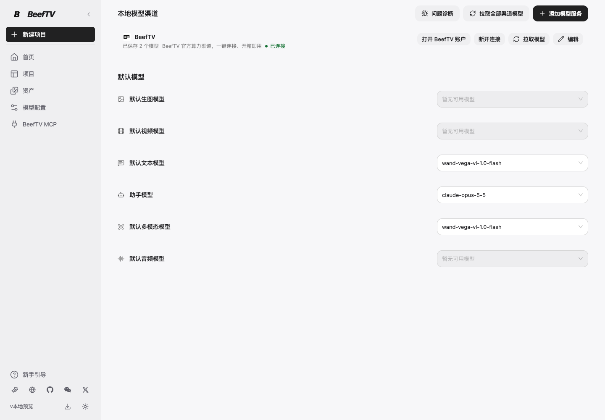
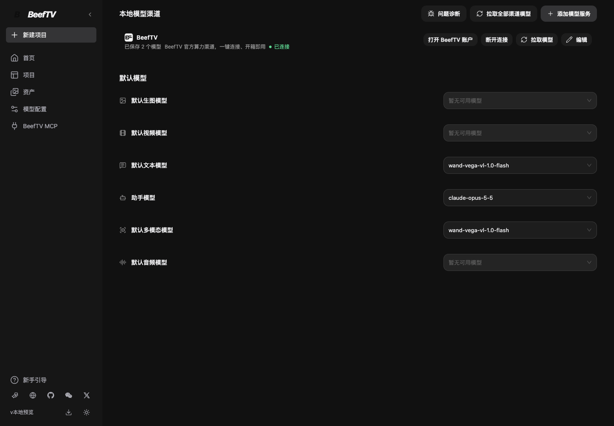
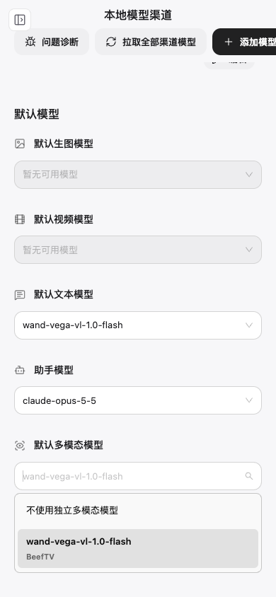

# 默认多模态模型设置验证

入口：侧栏「模型配置」→「默认模型」→「默认多模态模型」。沿用原有设置行和下拉样式。

截图来自本地当前源码的真实 SettingsPage 与工作台导航，使用隔离的模拟账号和模型目录，未调用付费模型，也不代表已发布。当前独立影音适配器支持 WAND `wand-vega-vl-1.0-flash` 的 chat-completion 接口及已配置别名。

验证结果：

- 浏览器实际选择 WAND、刷新保留、清空停用后再刷新；主助手选择保持不变。
- 模型设置浏览器矩阵覆盖桌面/390px、明暗主题、减少动画和新增下拉交互。新增选择项可操作，未新增页面宽度溢出。
- 前端专项 19 项/97 断言通过；助手模型浏览器文件 6 项/26 断言通过；模型设置矩阵 27 项通过，更新模拟目录的数量断言后剩余 1 项单独复跑通过。
- TypeScript 类型检查、ESLint、差异空白检查通过。
- 后端审片及模型选择专项通过：读取落盘选择，两个渠道分别使用对应凭据；清空、失效、禁用或协议不兼容时不发模型请求；托管 WAND 可作影音工具模型，主助手名单保持原边界。

本次未新增供应商付费验证；复用此前已验证的 WAND 影音请求格式，使用本地 HTTP 服务验证本次选择到请求的路由。UI 交叉 review 与发布仍需独立完成。
