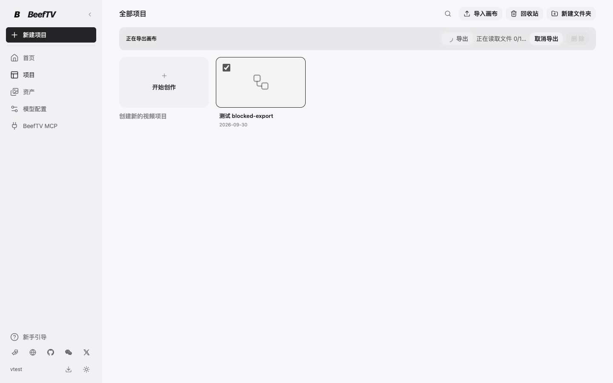
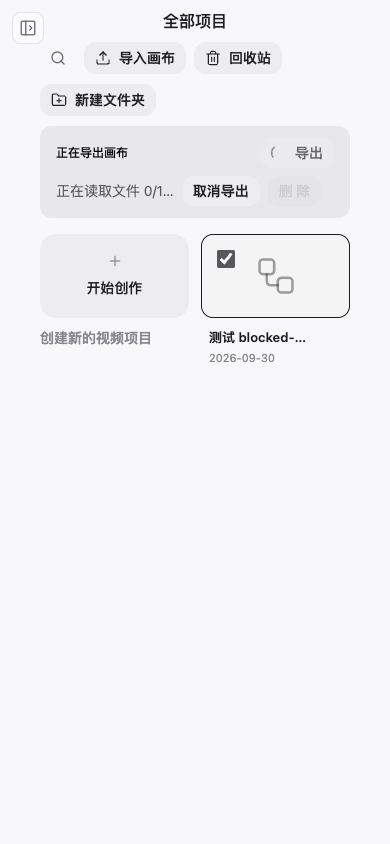

# 画布诊断与导出修复验收

对应 PR #199。本页截图来自本地浏览器中的实际 `UserLayout` 和 `CanvasPage` 组件，使用测试画布；不是已发布桌面版本，也不是客户数据。

操作路径：左侧「项目」→「全部项目」→勾选画布→顶部「导出」。测试故意阻塞一个素材读取，页面显示读取进度和「取消导出」。重复点击不会启动第二次导出；取消后，即使素材读取随后完成，也不会保存压缩包。取消勾选画布时，进行中的导出和取消入口仍保留。

桌面原生保存另由 Go 集成测试覆盖：包含 33 MiB 原文件的 ZIP 可完整读取且哈希一致；取消保存不创建备份资源；非法引用、路径和重复名称不会覆盖原文件。

诊断包升级验证使用临时 SQLite 数据和脱敏测试记录，覆盖持久任务诊断、任务和节点绑定快照、归属隔离、未知状态与缺失节点的区别。快照只代表采样时刻，不等同于完整的画布变更历史。

新增 `canvas-video-save-barrier.test.ts` 验证视频目标保存完成前不能提交任务，保存失败时不能提交。相同测试在隔离的 v1.7.24 源码上失败，在当前源码通过；提交入口使用本地替身，全程没有供应商调用。这项旧版缺陷已在 PR #179 修复并包含于 v1.7.26。它不等同于客户此次节点丢失的现场根因证明。
